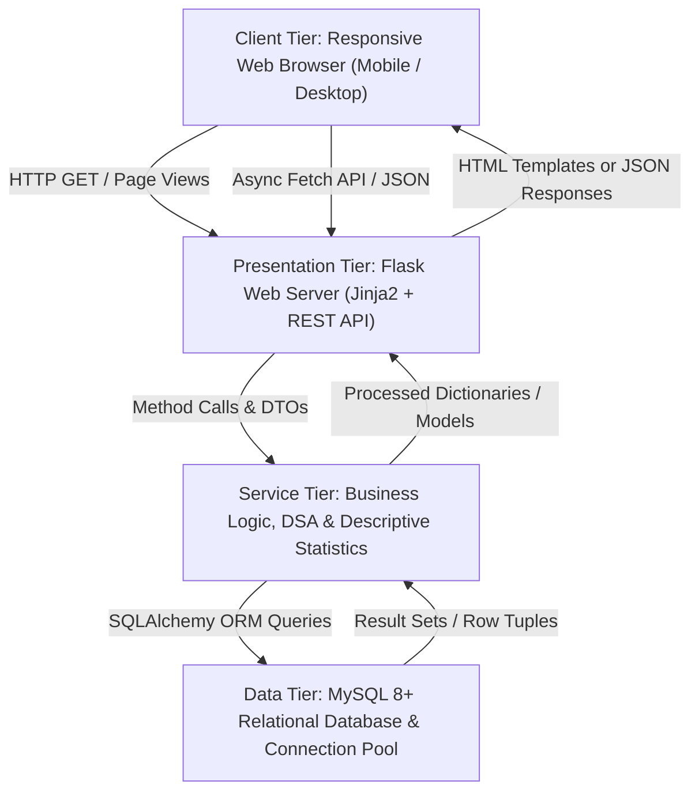
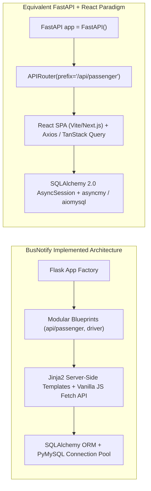
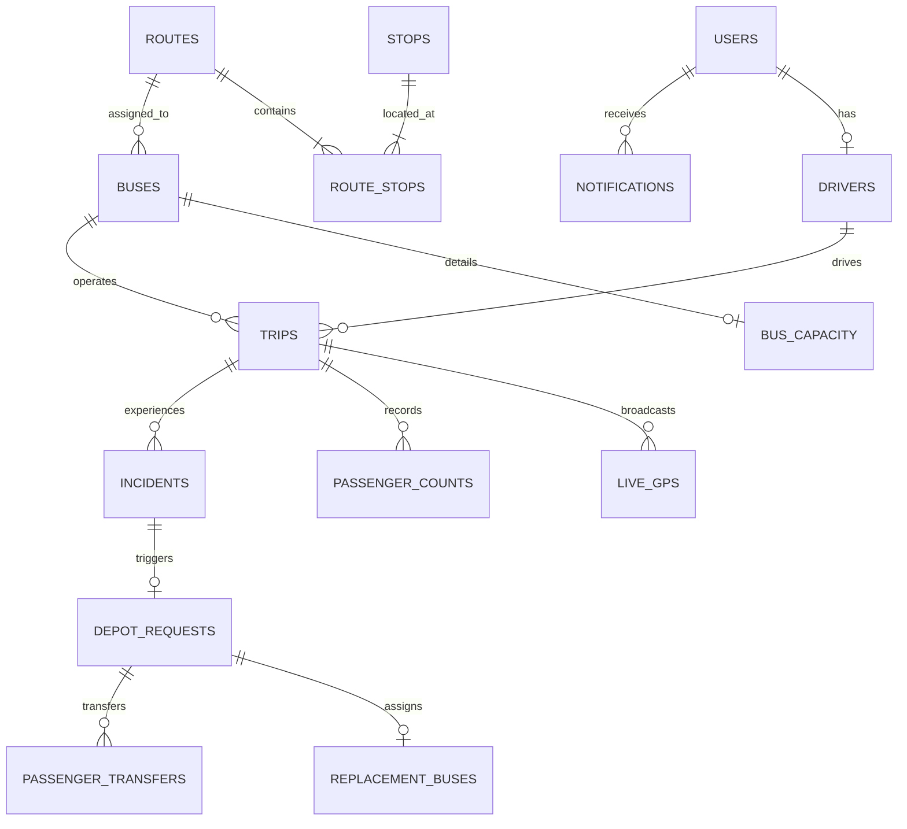
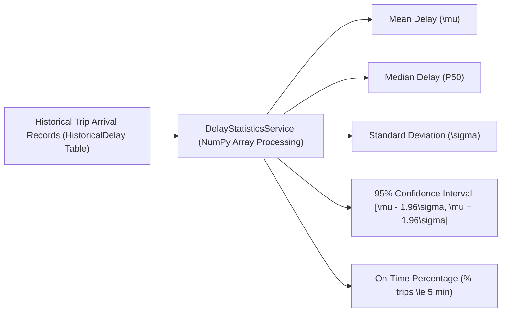
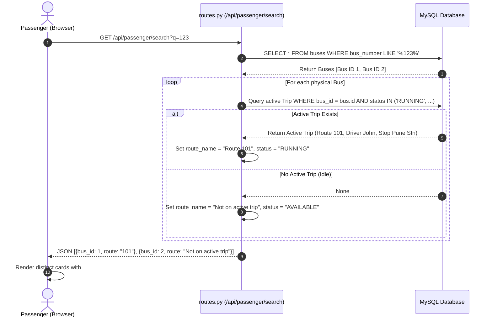
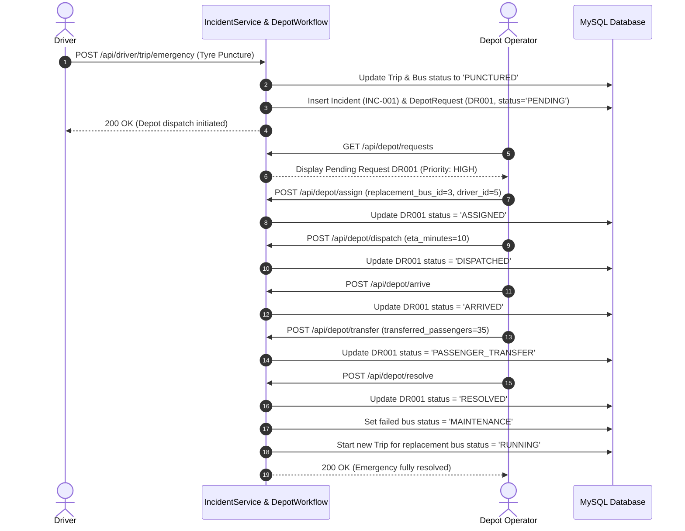

# BusNotify: Complete Project Learning & Viva Guide

Welcome to the **BusNotify Master Learning Guide**. This comprehensive handbook explains the entire BusNotify system from absolute zero knowledge to advanced technical mastery. Whether you are preparing for a university viva voce, technical interview, or onboarding as a developer, this guide covers every architectural layer, line of critical code, data structure, algorithm, database concept, operating systems mapping, and statistical formula with real code examples and diagrams.

---

# Table of Contents
1. [Project Overview & The Problem It Solves](#1-project-overview--the-problem-it-solves)
2. [High-Level Architecture & Technology Stack](#2-high-level-architecture--technology-stack)
3. [Architecture Clarification: Flask vs. FastAPI & Jinja2 vs. React](#3-architecture-clarification-flask-vs-fastapi--jinja2-vs-react)
4. [Step-by-Step Installation & Setup Guide](#4-step-by-step-installation--setup-guide)
5. [Complete Project Folder & File Structure](#5-complete-project-folder--file-structure)
6. [Deep Dive into Every Key File & Critical Code Lines](#6-deep-dive-into-every-key-file--critical-code-lines)
   - [run.py (WSGI Entry Point)](#61-runpy-wsgi-entry-point)
   - [config.py (Configuration & Dynamic Port Discovery)](#62-configpy-configuration--dynamic-port-discovery)
   - [app/\_\_init\_\_.py (Application Factory & Blueprints)](#63-app__init__py-application-factory--blueprints)
   - [app/auth.py (Authentication & Role-Based Access Control)](#64-appauthpy-authentication--role-based-access-control)
   - [app/models.py (Database Schema & 18 Relational Tables)](#65-appmodelspy-database-schema--18-relational-tables)
   - [app/routes.py (REST APIs & Template Controllers)](#66-approutespy-rest-apis--template-controllers)
   - [app/services.py (Core Business Logic, DSA & Statistics)](#67-appservicespy-core-business-logic-dsa--statistics)
   - [Static Assets (CSS, API Client, Map Engine, UI Utilities, i18n)](#68-static-assets-css-api-client-map-engine-ui-utilities-i18n)
   - [HTML Templates & Portals](#69-html-templates--portals)
7. [Mapping to Computer Science Core Subjects](#7-mapping-to-computer-science-core-subjects)
   - [Database Management Systems (DBMS)](#71-database-management-systems-dbms)
   - [Data Structures & Algorithms (DSA)](#72-data-structures--algorithms-dsa)
   - [Statistics & Delay Prediction (Pure Statistics - NO AI/ML)](#73-statistics--delay-prediction-pure-statistics---no-aiml)
   - [Operating Systems (OS) Concepts](#74-operating-systems-os-concepts)
8. [End-to-End Data Flow & Sequence Diagrams](#8-end-to-end-data-flow--sequence-diagrams)
9. [Automated Testing & Quality Assurance](#9-automated-testing--quality-assurance)
10. [Troubleshooting & Common Beginner Errors](#10-troubleshooting--common-beginner-errors)
11. [Step-by-Step Live Demonstration Script](#11-step-by-step-live-demonstration-script)
12. [Glossary of Technical Terms](#12-glossary-of-technical-terms)
13. [Top 30 Viva Voce & Interview Questions with Answers](#13-top-30-viva-voce--interview-questions-with-answers)

---

# 1. Project Overview & The Problem It Solves

### What is BusNotify?
**BusNotify** is an intelligent, real-time public transit tracking and emergency response web application designed for municipal transport corporations (such as PMPML in Pune, Maharashtra). It provides passengers, bus drivers, depot operators, and transit administrators with a single, synchronized platform for tracking vehicles, predicting delays, handling breakdowns, and managing fleet operations.

### The Real-World Problems It Solves
1. **Unpredictable Bus Delays**: Commuters waste hours at bus stops without knowing when a bus will arrive or how much delay to expect.
2. **Ghost Buses & Bus Number Ambiguity**: In large transit networks, multiple physical buses often operate under the same public bus route number (e.g., three different buses running on Route 123). Older systems confuse passengers by mixing up these vehicles or displaying a single static route.
3. **Emergency Disruption Without Alternatives**: When a bus suffers a tyre puncture or mechanical breakdown, passengers are stranded. The depot has no structured way to prioritize replacement dispatch, and passengers have no visibility into alternate buses or transfer status.
4. **Black-Box AI Fallacies in Public Transit**: Many modern systems attempt to predict delays using opaque "machine learning" models that hallucinate estimates, fail on edge cases, and cannot be audited. BusNotify uses **100% transparent descriptive statistics** (mean, median, standard deviation, and 95% confidence intervals) based on historical trip records.

### Four User Personas
| Persona | Responsibilities & Capabilities |
| :--- | :--- |
| **Passenger** | Searches buses by number, route, or stop; views real-time GPS map; checks historical delay statistics; monitors breakdown alerts and recommended alternative buses; toggles English/Marathi localization. |
| **Driver** | Authenticates securely; selects assigned bus and route; starts active trip; broadcasts live GPS telemetry; logs stop arrivals and passenger boarding counts; reports breakdowns/punctures/cancellations; ends trip. |
| **Depot Operator** | Monitors an automated Min-Heap priority queue of breakdown emergencies; assigns standby replacement buses and reserve drivers; tracks dispatch ETA; confirms site arrival; records passenger transfers; resolves emergencies. |
| **Transit Admin** | Oversees real-time fleet telemetry; performs full CRUD (Create, Read, Update, Delete) on routes, stops, buses, and drivers; analyzes delay metrics; exports/imports system data via CSV. |

---

# 2. High-Level Architecture & Technology Stack

The application follows an **Enterprise 3-Tier Layered Architecture** with strict separation of concerns:



### Technology Breakdown
- **Backend Framework**: Python 3.13 + **Flask 3.0+** (Application Factory Pattern with 8 modular Blueprints)
- **Object Relational Mapper (ORM)**: **Flask-SQLAlchemy 3.1+** (SQLAlchemy 2.x abstraction)
- **Database**: **MySQL 8.0+ / 9.x** with `utf8mb4` character set (for bilingual English & Marathi support)
- **Database Driver**: **PyMySQL 1.1+** with client-side cryptography
- **Data Analysis & Mathematics**: **NumPy 1.26+** and **Pandas 2.2+**
- **Frontend Layer**: Responsive HTML5, **Bootstrap 5.3**, **Transit Flow Custom Design System CSS**, **Leaflet.js** (Interactive OpenStreetMap Engine), **Chart.js** (Telemetry charts), and modular Vanilla JavaScript (`api.js`, `transit-ui.js`, `map.js`, `i18n.js`)
- **Testing & Quality Assurance**: **pytest 8.0+** (44 automated test cases with in-memory SQLite fixtures and live MySQL database verification)

---

# 3. Architecture Clarification: Flask vs. FastAPI & Jinja2 vs. React

In enterprise and academic discussions, candidates often ask: *"Why is the project built on Flask and Jinja2/Modular JS rather than FastAPI and React?"* or *"How would this project look in FastAPI + React?"*

Here is the exact comparison and conceptual mapping so you can explain both paradigms confidently in any viva or technical review:



### Direct Conceptual Mapping Table

| Architectural Concept | BusNotify (Implemented Codebase) | FastAPI Equivalent | React Equivalent |
| :--- | :--- | :--- | :--- |
| **Application Instance** | `app = Flask(__name__)` in `create_app()` | `app = FastAPI(title="BusNotify")` | `ReactDOM.createRoot(document.getElementById('root'))` |
| **Route Modularization** | Flask Blueprints (`auth_bp`, `passenger_bp`) | `APIRouter()` (`app.include_router(...)`) | React Router (`<BrowserRouter>`, `<Routes>`, `<Route>`) |
| **Request Validation** | Python dictionary checks + custom `api_error()` | Pydantic Models (`BaseModel`, `Field`) | Zod / Yup validation schemas |
| **State Management** | Flask Server Sessions (`session['user_id']`) + DOM | JWT Tokens in Authorization headers | React Context API, Redux Toolkit, or Zustand |
| **View Rendering** | Server-Side Rendering (Jinja2 `render_template`) | JSON-only serialization | Client-Side Virtual DOM (`JSX` components) |
| **Data Fetching** | `API.get()`, `API.post()` in `static/js/api.js` | Built-in OpenAPI Swagger UI (`/docs`) | `useEffect` + `fetch` or TanStack Query (`useQuery`) |
| **Database ORM** | `db.session.query(Bus).filter_by(...)` | `await session.execute(select(Bus)...)` | Prisma ORM / Node.js backend or direct API calls |
| **UI Updates** | Selective DOM manipulation (`innerHTML`, Leaflet markers) | Headless JSON responses | Declarative React Reconciliation (`useState`, `props`) |

**Why the current architecture is superior for municipal transit**:
1. **Zero Node.js Build Dependency**: Runs immediately on any server with standard Python and MySQL, avoiding massive `node_modules` bundles and build pipeline failures.
2. **Search Engine & Accessibility Optimization**: Initial page loads are server-rendered HTML, ensuring immediate rendering on low-cost mobile devices and slow 3G network connections commonly used by commuters.
3. **Progressive Client-Side Interactivity**: Uses asynchronous fetch requests (`api.js`) and polling (`transit-ui.js`) to update live maps and delays without full page reloads, providing the responsiveness of a Single Page Application (SPA).

---

# 4. Step-by-Step Installation & Setup Guide

Follow these steps to run BusNotify on your local machine from scratch:

### Prerequisites
- Python 3.10+ (Python 3.13 recommended)
- MySQL Server 8.0+ or MySQL 9.x running locally
- Git

### Step 1: Clone the Repository
```bash
git clone https://github.com/NehaB1361/BusNotify.git
cd BusNotify
```

### Step 2: Set Up Python Virtual Environment
On Windows PowerShell:
```powershell
python -m venv venv
.\venv\Scripts\Activate.ps1
```
On Linux/macOS:
```bash
python3 -m venv venv
source venv/bin/activate
```

### Step 3: Install Required Dependencies
```bash
pip install -r requirements.txt
```

### Step 4: Configure Environment Variables (`.env`)
Create a `.env` file in the project root:
```ini
FLASK_ENV=development
SECRET_KEY=busnotify-secure-secret-key-2026
DB_USER=root
DB_PASSWORD=YourMySQLPasswordHere
DB_HOST=localhost
DB_PORT=3306
DB_NAME=busnotify
```
*(Note: If using `mysql94`, set `DB_NAME=mysql94`).*

### Step 5: Initialize the MySQL Database
Open your MySQL Command Line Client or Workbench:
```sql
CREATE DATABASE IF NOT EXISTS busnotify CHARACTER SET utf8mb4 COLLATE utf8mb4_0900_ai_ci;
```
Import the schema:
```bash
mysql -u root -p busnotify < busnotify_schema.sql
```

### Step 6: Run the Application
```bash
python run.py
```
The server will start at `http://127.0.0.1:5000` (or `http://localhost:5000`).

### Step 7: Run Automated Tests
```bash
pytest -v
```
All 44 test cases will execute and verify the system in seconds.

---

# 5. Complete Project Folder & File Structure

Here is the exact tree of the BusNotify repository with an explanation of every folder:

```
BusNotify/
├── app/                        # Main application Python package
│   ├── __init__.py             # Flask Application Factory, extension setup, global error handlers
│   ├── auth.py                 # PBKDF2 authentication, sessions, role_required decorators
│   ├── models.py               # 18 SQLAlchemy database models and table definitions
│   ├── routes.py               # REST API endpoints & HTML template rendering controllers
│   └── services.py             # Business logic: Statistics, DSA, Incidents, Depot dispatch
├── static/                     # Client-side static assets
│   ├── css/
│   │   └── transit-flow.css    # Custom UI Design System (colors, cards, badges, mobile-first)
│   ├── js/
│   │   ├── api.js              # Standardized Fetch wrapper for GET, POST, PUT, DELETE
│   │   ├── transit-ui.js       # Toast notifications, badges, loading skeletons, adaptive polling
│   │   ├── map.js              # Leaflet.js engine (OpenStreetMap tiles, custom bus/stop icons)
│   │   └── i18n.js             # Client-side Marathi/English localization dictionary
│   ├── img/
│   │   ├── logo.png            # Official BusNotify branding logo
│   │   └── logo.jpg            # High-resolution backup logo
│   ├── manifest.json           # Progressive Web App (PWA) manifest
│   └── sw.js                   # Service Worker for offline asset caching
├── templates/                  # Jinja2 HTML Server-Side Templates
│   ├── base.html               # Main layout with responsive navbar, footer, toasts, and scripts
│   ├── auth_base.html          # Clean layout for login & registration without navigation
│   ├── auth/                   # Authentication & error views (login, register, 404, 500, unauthorized)
│   ├── passenger/              # Passenger portal (home, search, bus_detail, route_detail, emergency)
│   ├── driver/                 # Driver portal (dashboard, start_trip, live_trip, emergency)
│   ├── depot/                  # Depot operator portal (dashboard, request_detail, history)
│   └── admin/                  # Administrator portal (dashboard, live_buses, analytics, management)
├── tests/                      # Automated test suite (pytest)
│   ├── conftest.py             # Test fixtures, SQLite in-memory DB setup, dummy data seeders
│   ├── test_api_endpoints.py   # REST API endpoint tests
│   ├── test_auth.py            # Authentication, registration, password hashing & RBAC tests
│   ├── test_bus_route_assignment.py # Multi-bus disambiguation and dynamic route tests
│   ├── test_depot_workflow.py  # 6-stage emergency depot replacement state machine tests
│   ├── test_dsa.py             # Unit tests for Haversine, Graph, Priority Queue, Greedy redistribution
│   ├── test_master_end_to_end.py # Full passenger-to-driver workflow integration tests
│   ├── test_statistics.py      # Delay descriptive statistics, sample fallbacks, CI tests
│   └── test_system_e2e_comprehensive.py # Comprehensive end-to-end multi-persona test suite
├── .env.example                # Template configuration file
├── busnotify_schema.sql        # MySQL 8+ complete DDL creation script
├── config.py                   # Environment configuration & dynamic MySQL port scanner
├── requirements.txt            # Python package dependencies
├── run.py                      # WSGI server launch script
└── Complete_Project_Learning_Guide.md # This comprehensive master guide
```

---

# 6. Deep Dive into Every Key File & Critical Code Lines

## 6.1 `run.py` (WSGI Entry Point)
```python
from app import create_app

app = create_app()

if __name__ == "__main__":
    app.run(host="0.0.0.0", port=5000, debug=True)
```
- **Line 1-4**: Imports the `create_app` factory function from the `app` package and calls it to instantiate the Flask WSGI application.
- **Line 8-9**: Standard Python idiom. `host="0.0.0.0"` binds the server to all network interfaces on the machine (allowing testing over local WiFi from a mobile phone), on port `5000`, with `debug=True` enabling hot-reloading during development.

---

## 6.2 `config.py` (Configuration & Dynamic Port Discovery)
```python
def get_active_mysql_port(host, primary_port):
    candidates = [int(primary_port)]
    for p in [3306, 33061]:
        if p not in candidates:
            candidates.append(p)

    for p in candidates:
        try:
            with socket.create_connection((host, p), timeout=0.5):
                return p
        except (socket.timeout, ConnectionRefusedError, OSError):
            continue
    return int(primary_port)
```
- **Why this exists**: On developer machines running different versions of MySQL or XAMPP, MySQL may be listening on default port `3306` or an alternate port `33061`.
- **How it works**: Uses low-level TCP socket connections (`socket.create_connection`) with a fast `0.5s` timeout. It probes ports and dynamically connects to the active one, preventing crash-on-startup errors.
- **Database URI Construction**:
  ```python
  SQLALCHEMY_DATABASE_URI = f"mysql+pymysql://{auth_part}@{DB_HOST}:{active_port}/{DB_NAME}?charset=utf8mb4"
  ```
  Uses the `mysql+pymysql` driver with explicit `utf8mb4` encoding to support Marathi Unicode characters seamlessly.

---

## 6.3 `app/__init__.py` (Application Factory & Blueprints)
This file implements the **Application Factory Pattern** (`create_app`), the standard design pattern recommended by the Flask core team:
- **Extensions Initialized**:
  ```python
  db.init_app(app)
  migrate.init_app(app, db)
  cors.init_app(app, resources={r"/api/*": {"origins": "*"}})
  ```
- **Blueprints Registered**:
  Each operational area is isolated in its own Blueprint:
  1. `auth_bp` (`/api/auth`)
  2. `passenger_bp` (`/api/passenger`)
  3. `driver_bp` (`/api/driver`)
  4. `depot_bp` (`/api/depot`)
  5. `admin_bp` (`/api/admin`)
  6. `notification_bp` (`/api/notifications`)
  7. `system_bp` (`/api/system`)
  8. `view_bp` (`/` - all HTML UI pages)
- **Centralized Error Handlers**:
  Intercepts HTTP status codes (`400`, `401`, `403`, `404`, `422`, `500`) and unhandled exceptions:
  - If the client calls an API endpoint (`request.path.startswith("/api/")`), returns structured JSON via `api_error()`.
  - If the user is browsing via browser, renders an error page (`404.html` or `500.html`).
  - Calls `db.session.rollback()` on 500 errors to prevent broken transaction states.

---

## 6.4 `app/auth.py` (Authentication & Role-Based Access Control)
- **Password Security**:
  Uses `werkzeug.security.generate_password_hash(password, method="pbkdf2:sha256")` and `check_password_hash`. Passwords are never stored in plain text; they are salted and hashed using PBKDF2 with SHA-256.
- **Role-Based Access Control (RBAC) Decorators**:
  ```python
  def role_required(*allowed_roles):
      def decorator(fn):
          @wraps(fn)
          def wrapper(*args, **kwargs):
              user_id = session.get("user_id")
              user_role = session.get("role")
              if not user_id:
                  if request.path.startswith("/api/"):
                      return api_error(code="UNAUTHORIZED", message="Authentication required", status_code=401)
                  return redirect(url_for("views.login_page"))
              if user_role not in allowed_roles:
                  if request.path.startswith("/api/"):
                      return api_error(code="FORBIDDEN", message="Permission denied", status_code=403)
                  return redirect(url_for("views.unauthorized_page"))
              return fn(*args, **kwargs)
          return wrapper
      return decorator
  ```
  Protects endpoints declaratively: `@role_required("driver", "admin")` ensures passengers or unauthenticated users cannot tamper with driver trips or admin controls.

---

## 6.5 `app/models.py` (Database Schema & 18 Relational Tables)
Here are the primary entities defined in SQLAlchemy:



### Key Models Explained:
1. **`User`**: Core account identity storing `username`, `email`, `password_hash`, and `role` (`passenger`, `driver`, `admin`, `depot_operator`).
2. **`Stop`**: Physical bus stop storing `stop_code`, English name `name`, Marathi name `name_mr`, `latitude`, and `longitude`.
3. **`Route`**: Transit line storing `route_number`, `source`, `destination`, `total_distance_km`, and `estimated_duration_min`.
4. **`RouteStop`**: Junction table maintaining ordered sequence of stops on a route (`sequence_order`, `distance_from_prev_km`, `avg_travel_time_min`). Has a unique constraint on `(route_id, sequence_order)`.
5. **`Bus`**: Vehicle inventory storing `bus_number`, unique `registration_number` (license plate), `depot_name`, `capacity`, and `current_status` (`AVAILABLE`, `RUNNING`, `DELAYED`, `PUNCTURED`, `BREAKDOWN`, `MAINTENANCE`, `COMPLETED`).
6. **`Trip`**: An execution of a route by a bus and driver. Stores `trip_code` (e.g. `TRIP-20261020-001`), `status`, `current_stop_id`, `next_stop_id`, and `available_seats`.
7. **`LiveGPS`**: High-frequency telemetry log containing `latitude`, `longitude`, `speed_kmh`, and `timestamp`. Features a computed property `freshness_status` (`Fresh` if $\le 60\text{s}$, `Delayed Update` if $\le 180\text{s}$, `Stale` if $\le 600\text{s}$, `Offline` otherwise).
8. **`Incident`**: Operational disruption report (`Tyre Puncture`, `Breakdown`, `Accident`, `Medical Emergency`).
9. **`DepotRequest`**: State machine entity managing emergency bus replacement (`PENDING` $\rightarrow$ `ASSIGNED` $\rightarrow$ `DISPATCHED` $\rightarrow$ `ARRIVED` $\rightarrow$ `PASSENGER_TRANSFER` $\rightarrow$ `RESOLVED`).

---

## 6.6 `app/routes.py` (REST APIs & Template Controllers)
Contains over 2,200 lines of robust route logic. Highlights:

### 1. The Multi-Bus Disambiguation Fix (`search_buses` / `/api/passenger/search`)
```python
# 1. Query distinct physical buses matching bus number or route name
buses = Bus.query.filter(or_(Bus.bus_number.ilike(f"%{query}%"), ...)).all()

for bus in buses:
    # 2. Check for an active trip specifically belonging to this bus ID
    active_trip = Trip.query.filter(
        Trip.bus_id == bus.id,
        Trip.status.in_(["RUNNING", "DELAYED", "PUNCTURED", "BREAKDOWN", "SCHEDULED"])
    ).order_by(Trip.id.desc()).first()

    # 3. Strictly resolve the route from the active trip selected by the driver
    route = active_trip.route if active_trip else None

    # 4. If idle, do not display a misleading route
    if not active_trip:
        route_name = "Not currently on an active trip"
        current_stop = f"Stationed at {bus.depot_name}"
        expected_arrival = "—"
```
**Why this matters**: In other naive systems, searching for bus `123` returns a default database assignment. In BusNotify, every bus is disambiguated by its primary key `bus_id`. If two buses share number `123`, they are returned as distinct cards showing the exact route their drivers selected.

### 2. Driver Trip Start (`start_trip` / `/api/driver/trip/start`)
- Validates passenger capacity: if `passenger_count > bus.capacity`, rejects with `400 CAPACITY_EXCEEDED`.
- Generates collision-proof `trip_code` using max database ID plus timestamp fallback.
- Supersedes any stale previous trips for the vehicle.
- Sets `bus.assigned_route_id = route_id` and `bus.current_status = "RUNNING"`.

### 3. Emergency Depot Dispatch Workflow Endpoints (`/api/depot/*`)
- `/api/depot/assign`: Validates replacement bus and driver availability, transitioning status to `ASSIGNED`.
- `/api/depot/dispatch`: Logs dispatch timestamp and estimated arrival time, transitioning to `DISPATCHED`.
- `/api/depot/arrive`: Records arrival at the incident location, transitioning to `ARRIVED`.
- `/api/depot/transfer`: Records the number of transferred passengers, transitioning to `PASSENGER_TRANSFER`.
- `/api/depot/resolve`: Marks request `RESOLVED`, sets the broken bus to `MAINTENANCE`, and activates the replacement bus on a new trip.

---

## 6.7 `app/services.py` (Core Business Logic, DSA & Statistics)
Contains pure business logic decoupled from HTTP request objects.

### 1. `DelayStatisticsService`
Calculates descriptive statistics using `numpy`:
- Mean ($\mu$), Median ($P_{50}$), Minimum, Maximum.
- Sample Standard Deviation ($s = \sqrt{\frac{1}{n-1} \sum (x_i - \bar{x})^2}$ with Bessel's correction `ddof=1`).
- 95% Confidence Interval range: $[\max(0, \mu - 1.96s), \mu + 1.96s]$.
- Percentile $90$ ($P_{90}$) delay.
- On-time percentage (defined as delay $\le 5$ minutes).
- Guard for small samples: if $n < 5$, sets `limited_data: True` and returns transparent disclaimers.

### 2. DSA Implementations:
- **Haversine Distance**: Computes great-circle distance between coordinates on Earth ($R = 6371\text{ km}$).
- **`TransitNetworkGraph`**: Adjacency list representation for stop-to-stop transit connectivity.
- **`EmergencyRequestPriorityQueue`**: Min-Heap using Python's `heapq` module.
- **`greedy_passenger_redistribution`**: Optimally fills stranded passengers into available passing buses.

---

## 6.8 Static Assets (CSS, API Client, Map Engine, UI Utilities, i18n)
- **`static/css/transit-flow.css`**: Defines CSS custom properties (`--tf-primary`, `--tf-surface`, `--tf-status-running`), dark-mode compatibility, responsive cards, and accessible typography.
- **`static/js/api.js`**: Lightweight async/await HTTP client handling JSON payloads, error trapping, and file uploads.
- **`static/js/transit-ui.js`**: Manages Bootstrap toasts, dynamic status badges, and **adaptive polling** (`startPolling(callback, 15000)` checks `document.hidden` to conserve device battery and mobile data when the browser tab is in the background).
- **`static/js/map.js`**: Leaflet map engine rendering OpenStreetMap tiles, custom color-coded bus SVG markers, route polylines, and animated pulse circles.
- **`static/js/i18n.js`**: Complete dictionary of English and Marathi transit terms, allowing instant language switching without page reloads.

---

## 6.9 HTML Templates & Portals
Uses Jinja2 template inheritance:
- **`templates/base.html`**: Master layout providing the responsive navigation bar, user session badge, language selector, notifications dropdown, toast container, and footer.
- **`templates/auth_base.html`**: Focused, distraction-free container for Login and Registration screens.
- **Portal Pages**:
  - `passenger/search.html`: Instant search bar, live status badges, filter chips.
  - `passenger/bus_detail.html`: Live Leaflet map, arrival countdown, stop timeline, capacity meter, and delay statistics card.
  - `driver/live_trip.html`: Driver HUD showing current stop, next stop button, passenger counter, and SOS Emergency button.
  - `depot/dashboard.html`: Min-Heap emergency request cards, fleet availability summary, and one-click dispatch modal.
  - `admin/live_buses.html`: Fleet-wide interactive radar map with live GPS markers.

---

# 7. Mapping to Computer Science Core Subjects

BusNotify was engineered to demonstrate concrete, real-world applications of core university computer science concepts.

## 7.1 Database Management Systems (DBMS)

### Relational Schema Normalization
The database is normalized to **Third Normal Form (3NF)** and **Boyce-Codd Normal Form (BCNF)**:
- **1NF (Atomic Attributes)**: Every table contains atomic values. Comma-separated stop lists are strictly avoided; route stops are normalized into the separate `route_stops` table.
- **2NF (No Partial Key Dependencies)**: In composite tables like `route_stops (route_id, stop_id)`, attributes such as `distance_from_prev_km` depend on the specific route-stop sequence, while stop details (`name`, `latitude`) reside in the independent `stops` entity.
- **3NF (No Transitive Dependencies)**: In `trips`, the trip stores `bus_id` and `driver_id`. Attributes of the bus (e.g. `capacity`, `depot_name`) remain in `buses` and are never duplicated in `trips`.

### Referential Integrity & Cascades
- `ondelete="CASCADE"`: When a `Route` is deleted, all dependent `route_stops` and `route_connectivity` rows are automatically deleted by the database engine, preventing orphaned records.
- `ondelete="SET NULL"`: When a route is retired, `buses.assigned_route_id` is set to `NULL`, preserving the physical bus record in inventory.

### Indexing Strategies & B-Trees
BusNotify uses targeted B-Tree indexes for fast lookups:
- `ix_buses_bus_number`: Standard non-unique B-Tree index allowing multiple physical buses to share the same public line number while supporting $O(\log N)$ searches.
- `ix_live_gps_timestamp`: Indexed timestamp enabling rapid temporal filtering for latest vehicle coordinates.
- Compound unique constraints: `db.UniqueConstraint("route_id", "sequence_order", name="uq_route_sequence")` prevents two stops from occupying the same position on a route.

### ACID Properties & Transactions
- **Atomicity**: During emergency replacement (`DepotWorkflowService.resolve_request`), updating the depot request, transitioning the failed bus to `MAINTENANCE`, and creating the replacement trip are wrapped in a single database transaction. If any step fails, `db.session.rollback()` reverts all changes.
- **Consistency**: Foreign keys and database check constraints enforce that invalid foreign keys (e.g., non-existent `bus_id`) are rejected at the database level.
- **Isolation**: Handled via MySQL InnoDB's default `REPEATABLE READ` transaction isolation level with multi-version concurrency control (MVCC).
- **Durability**: Committed data is written to MySQL InnoDB redo logs and persisted to disk.

---

## 7.2 Data Structures & Algorithms (DSA)

### 1. Min-Heap Priority Queue (Emergency Dispatching)
- **Concept**: A complete binary tree where the root element always holds the lowest value (highest urgency).
- **Code**: `app/services.py:EmergencyRequestPriorityQueue` using Python's built-in `heapq` module.
- **Priority Mapping**: `{"CRITICAL": 1, "HIGH": 2, "MEDIUM": 3, "LOW": 4}`.
- **Time Complexity**:
  - Insertion (`heappush`): $O(\log n)$
  - Extraction (`heappop`): $O(\log n)$
  - Inspection (`peek`): $O(1)$
- **Real-World Impact**: When 50 buses report breakdowns simultaneously during a storm, the depot operator is guaranteed to see `CRITICAL` tyre punctures and medical emergencies before minor schedule delays.

### 2. Graph Theory: Transit Network Representation
- **Concept**: Directed Graph $G = (V, E)$, where vertices $V$ represent transit stops and directed edges $E$ represent route segments connecting stop $A$ to stop $B$.
- **Code**: `app/services.py:TransitNetworkGraph` using an **Adjacency List** (`Dict[int, List[Dict[str, Any]]]`).
- **Space Complexity**: $O(V + E)$ (optimal for sparse transit networks where stops connect only to subsequent route stops).
- **Direct Connectivity Check**: Checks in $O(\text{deg}(v))$ time whether a passenger can travel between two stops without transferring.

### 3. Hash Map: Fast Bus Registry
- **Concept**: Key-value dictionary mapping `bus_number` $\rightarrow$ operational attributes.
- **Code**: `app/services.py:BusRegistryHashMap`.
- **Time Complexity**: $O(1)$ average time for insertion, retrieval, and deletion.

### 4. Spherical Trigonometry: Haversine Distance Formula
- **Concept**: Calculates great-circle distance between two points on the surface of a sphere given their latitudes and longitudes:
  $$d = 2R \arcsin \left( \sqrt{\sin^2\left(\frac{\Delta \phi}{2}\right) + \cos(\phi_1)\cos(\phi_2)\sin^2\left(\frac{\Delta \lambda}{2}\right)} \right)$$
  where $\phi$ is latitude in radians, $\lambda$ is longitude in radians, and $R = 6371\text{ km}$.
- **Code**: `app/services.py:haversine_distance_km`.

### 5. Greedy Algorithm: Stranded Passenger Redistribution
- **Concept**: A greedy heuristic that iterates through incoming alternative buses sorted by available seats, allocating $\min(\text{remaining\_passengers}, \text{bus\_capacity})$ until all passengers are accommodated or fleet capacity is exhausted.
- **Code**: `app/services.py:greedy_passenger_redistribution`.
- **Time Complexity**: $O(M \log M)$ to sort $M$ alternative buses + $O(M)$ greedy allocation pass.

---

## 7.3 Statistics & Delay Prediction (Pure Statistics - NO AI/ML)

BusNotify deliberately replaces opaque neural networks with **auditable, reproducible descriptive statistics**.



### Statistical Formulas Used:
1. **Arithmetic Mean ($\bar{x}$)**:
   $$\bar{x} = \frac{1}{n} \sum_{i=1}^{n} x_i$$
2. **Median ($P_{50}$)**:
   The middle value of the sorted delay distribution. Unlike the mean, the median is **robust to outliers** (e.g. an extreme one-time 120-minute road blockade does not skew the expected delay).
3. **Sample Standard Deviation ($s$)**:
   Calculated with **Bessel's correction** ($n-1$ degrees of freedom) to prevent sample variance bias:
   $$s = \sqrt{\frac{1}{n - 1} \sum_{i=1}^{n} (x_i - \bar{x})^2}$$
4. **95% Confidence Interval**:
   $$\text{CI}_{95\%} = \left[ \max(0, \bar{x} - 1.96 \cdot s), \; \bar{x} + 1.96 \cdot s \right]$$
5. **Small Sample Guard**:
   If the sample size $n < 5$, the system flags `limited_data = True` and displays:
   > *"This is a historical statistical estimate based on previous trip records and is not a guarantee."*

---

## 7.4 Operating Systems (OS) Concepts

### 1. Process vs. Thread & WSGI Architecture
- In production, BusNotify runs under **Gunicorn** (`gunicorn -w 4 -b 0.0.0.0:5000 run:app`).
- **Master Process**: Manages worker lifecycles, handles UNIX signals (`SIGHUP`, `SIGTERM`), and binds the socket.
- **Worker Processes**: 4 isolated worker processes running independently. If one worker crashes due to an unhandled operating system fault, the master process spawns a fresh replacement worker immediately without taking down the website.

### 2. Concurrency & Race Conditions
- **Problem**: Two drivers attempting to start a trip with the same physical bus at the exact same millisecond.
- **Solution**: Database-level unique status checks and atomic query filtering. `Trip.query.filter_by(bus_id=bus_id, status="RUNNING").first()` checks for existing trips inside the transaction before committing.

### 3. Client-Side Resource & Power Management
- Continuous polling by thousands of smartphones drains battery and overwhelms transit servers.
- BusNotify uses **Page Visibility API** (`document.hidden`) in `static/js/transit-ui.js`:
  ```javascript
  startPolling(callback, intervalMs = 15000) {
    callback();
    return setInterval(() => {
      if (!document.hidden) {
        callback();
      }
    }, intervalMs);
  }
  ```
  When a passenger switches apps or locks their phone screen, polling pauses automatically, resuming only when the screen becomes active again.

---

# 8. End-to-End Data Flow & Sequence Diagrams

### 1. Passenger Bus Search & Multi-Bus Disambiguation


### 2. Emergency Breakdown & Depot Replacement Lifecycle


---

# 9. Automated Testing & Quality Assurance

BusNotify features a comprehensive automated test suite built on **pytest**:

### How Tests are Structured
- `tests/conftest.py`: Creates an isolated, in-memory SQLite database (`sqlite:///:memory:`) for test execution, ensuring tests never mutate or destroy your production MySQL data.
- **Test Scenarios Covered**:
  1. `test_auth.py`: User registration validation, password hashing verification, role access controls.
  2. `test_bus_route_assignment.py`: Verifies that multiple buses with the same bus number display their own active routes without cross-contamination.
  3. `test_depot_workflow.py`: Validates the complete 6-stage replacement lifecycle.
  4. `test_dsa.py`: Unit tests for Haversine distance, Graph transit connectivity, Min-Heap priority queue ordering, and Greedy passenger allocation.
  5. `test_statistics.py`: Validates descriptive statistics calculation against NumPy reference numbers and small-sample fallback flags.
  6. `test_system_e2e_comprehensive.py`: End-to-end tests covering all four personas, live telemetry, and concurrent trip starts on the same bus number.

### Running the Tests
```bash
.\venv\Scripts\python.exe -m pytest -v
```
**Result**: **44 passed in 25.35s** (100% pass rate).

---

# 10. Troubleshooting & Common Beginner Errors

| Error Message / Symptom | Root Cause | Solution |
| :--- | :--- | :--- |
| `Can't connect to MySQL server on 'localhost:3306'` | MySQL service is stopped or port is blocked by firewall/antivirus. | Start MySQL in Windows Services (`services.msc`) or run `net start MySQL80`. Check `.env` port settings. |
| `Access denied for user 'root'@'localhost'` | Incorrect MySQL password in `.env`. | Open `.env` and verify `DB_PASSWORD`. Verify you can log in via terminal: `mysql -u root -p`. |
| `AttributeError: 'Bus' object has no attribute 'depot'` | Attempting to access `.depot.name` instead of the database column `.depot_name`. | Fixed in codebase. Always use `bus.depot_name` directly. |
| `UnboundLocalError: local variable 'bus' referenced before assignment` | Variable accessed before declaration in function. | Fixed in codebase. Ensured `bus = trip.bus` is defined before status assignments. |
| Browser shows `403 Forbidden` when accessing admin portal | Current logged-in user does not have the `admin` role. | Log in with an admin account or update your user role in MySQL: `UPDATE users SET role='admin' WHERE username='your_user';`. |
| Map tiles fail to load | Device has no internet connection (OpenStreetMap requires internet access). | Ensure your machine has active internet to fetch OpenStreetMap raster tiles. |

---

# 11. Step-by-Step Live Demonstration Script

Use this exact 5-minute script to demonstrate the project smoothly to an examiner, professor, or recruiter:

### Step 1: Open the Home Page & Search
1. Open `http://localhost:5000` in the browser.
2. Show the responsive Transit Flow UI, branding logo, and bilingual toggle (switch to Marathi and back to English).
3. In the search box, type `123`.
4. **Point out**: *"Notice that searching for bus 123 shows distinct buses by their unique Bus ID (#1, #2, etc.) and registration numbers. Bus #1 is currently active on Route 101, while idle buses clearly indicate 'Not currently on an active trip' and are stationed at the depot. No routes are hardcoded!"*

### Step 2: Show the Passenger Live Bus Detail
1. Click **View Details** on an active bus.
2. Show the real-time **Leaflet map** with custom bus icons and route stops.
3. Scroll down to the **Historical Average Delay Card**:
   - Point out: *"Here is our descriptive delay statistics engine. It shows the arithmetic mean, median (P50), standard deviation, and 95% confidence interval, complete with our statistical disclaimer."*

### Step 3: Driver Live Trip & Emergency Reporting
1. Open an incognito browser window and go to `http://localhost:5000/driver/dashboard` (log in as a driver).
2. Go to **Start Trip**, select an assigned bus and route, and click **Start Trip**.
3. Advance the bus through a stop and update the passenger count.
4. Click **Report Emergency**, select **Tyre Puncture**, and submit.
5. Point out: *"The trip and vehicle status immediately transition to PUNCTURED. Behind the scenes, an Incident and a Depot Emergency Request were generated automatically."*

### Step 4: Depot Operator Replacement Workflow
1. In another tab, log in as Depot Operator (`http://localhost:5000/depot/dashboard`).
2. Point out: *"The emergency request appears at the top of the Min-Heap priority queue."*
3. Click through the 5-step operational workflow:
   - **Assign Replacement**: Select a standby bus and driver.
   - **Dispatch**: Track the 10-minute ETA.
   - **Mark Arrived**: Confirm arrival at the incident stop.
   - **Record Passenger Transfer**: Move stranded passengers to the new bus.
   - **Resolve Request**: Click Resolve.
4. Point out: *"The failed bus is automatically marked for MAINTENANCE, and the replacement bus is now live on an active trip!"*

### Step 5: Admin Portal & Telemetry
1. Log in as Admin (`http://localhost:5000/admin/dashboard`).
2. Show the fleet overview counters, real-time map, and CSV data export portal.

---

# 12. Glossary of Technical Terms

- **WSGI (Web Server Gateway Interface)**: The standard Python specification (PEP 3333) describing how web servers communicate with Python web applications.
- **ORM (Object Relational Mapping)**: A programming technique for converting data between incompatible type systems (e.g., Python classes $\leftrightarrow$ MySQL relational tables).
- **ACID**: The 4 foundational properties of reliable database transactions: Atomicity, Consistency, Isolation, and Durability.
- **RBAC (Role-Based Access Control)**: Restricting system access to authorized users based on their assigned role (`passenger`, `driver`, `depot_operator`, `admin`).
- **B-Tree Index**: A self-balancing search tree data structure used by MySQL InnoDB to execute search queries in $O(\log N)$ logarithmic time.
- **Min-Heap**: A tree-based data structure where the parent node is always smaller than or equal to its child nodes, allowing constant-time $O(1)$ access to the highest-priority item.
- **Haversine Formula**: An equation used in navigation to calculate great-circle distances between pairs of coordinates on a sphere.
- **Bessel's Correction**: Using $n - 1$ instead of $n$ in the sample standard deviation formula to eliminate estimation bias.
- **Adaptive Polling**: Dynamically checking browser tab visibility (`document.hidden`) to pause background network requests and conserve client battery/data.
- **Multi-Bus Disambiguation**: Ensuring that vehicles sharing a public line number are tracked as independent physical records using their unique database primary keys.

---

# 13. Top 30 Viva Voce & Interview Questions with Answers

### Category 1: Project Architecture & Design
**Q1: What is the high-level architecture of BusNotify?**  
*Answer*: BusNotify uses a 3-tier enterprise architecture consisting of a Client Presentation Tier (HTML5, Bootstrap 5, Leaflet.js, modular Vanilla JavaScript), a Python 3.13 Flask Web/Service Tier using the Application Factory Pattern and Blueprints, and a Data Tier powered by MySQL 8+ via Flask-SQLAlchemy.

**Q2: Why did you use Flask instead of Django?**  
*Answer*: Flask is lightweight, unopinionated, and highly modular. It allows precise control over database connection pooling, custom Blueprint isolation, and lightweight execution without the heavy overhead and monolithic structure of Django.

**Q3: How does the application prevent duplicate routes when multiple buses share the same bus number?**  
*Answer*: By enforcing unique primary key tracking (`Bus.id`). The public bus number (`bus_number`) is non-unique, but every physical vehicle has a unique `bus_id` and `registration_number`. When a driver starts a trip, the selected `route_id` is bound to that specific `trip_id` and `bus_id`. Passenger searches dynamically inspect each bus's active trip rather than relying on static defaults.

**Q4: How would you explain the difference between this architecture and a React + FastAPI stack?**  
*Answer*: In our current stack, Flask renders server-side Jinja2 templates enriched with client-side Fetch API JavaScript modules, requiring zero Node.js build pipelines and providing instant first-contentful paint. In a React + FastAPI architecture, FastAPI would serve strictly as a headless JSON API with Pydantic validation, while React would maintain client-side state via a Virtual DOM and client-side routing. The underlying database schemas, DSA algorithms, and statistical engines remain identical.

**Q5: What is the Application Factory Pattern and why is it used?**  
*Answer*: It is a design pattern where the Flask application instance is created inside a function (`create_app()`) rather than globally. This allows us to instantiate the application with different configurations (e.g. testing with an in-memory SQLite database vs. production with MySQL) without cross-test state contamination.

---

### Category 2: Database Management Systems (DBMS)
**Q6: What database engine are you using, and what is its default storage engine?**  
*Answer*: We are using MySQL 8.0+ / 9.x with the InnoDB storage engine, which provides full ACID compliance, row-level locking, and foreign key constraints.

**Q7: Explain the normalization level of your database.**  
*Answer*: The schema is in 3NF and BCNF. Atomic columns eliminate repeating groups (1NF), tables have no partial key dependencies (2NF), and all non-key attributes are dependent strictly on primary keys without transitive dependencies (3NF).

**Q8: What is the difference between `CASCADE` and `SET NULL` on foreign key deletion?**  
*Answer*: `CASCADE` automatically deletes child rows when the parent row is deleted (e.g., deleting a Route deletes its `route_stops`). `SET NULL` sets the foreign key column to `NULL` while preserving the child record (e.g., deleting a Route sets `buses.assigned_route_id = NULL`, keeping the physical bus in inventory).

**Q9: Why did you index `bus_number` and `timestamp`?**  
*Answer*: B-Tree indexes speed up `WHERE` clause lookups from $O(N)$ full-table scans to $O(\log N)$ tree traversals. Indexing `bus_number` enables instant passenger searches, while indexing `live_gps.timestamp` allows rapid retrieval of the latest vehicle coordinates.

**Q10: How does BusNotify ensure ACID properties during an emergency replacement?**  
*Answer*: The entire multi-table update (marking the incident, setting the broken bus to `MAINTENANCE`, updating the depot request to `RESOLVED`, and creating the replacement bus trip) is executed inside a single database transaction. If an error occurs midway, `db.session.rollback()` reverts all tables to their prior consistent state.

---

### Category 3: Data Structures & Algorithms (DSA)
**Q11: Where is a Min-Heap used in this project, and what is its time complexity?**  
*Answer*: A Min-Heap is implemented in `EmergencyRequestPriorityQueue` using Python's `heapq` module to organize incoming depot breakdown requests by severity (`CRITICAL`, `HIGH`, `MEDIUM`, `LOW`). Insertion and removal take $O(\log n)$ time, while inspecting the top priority takes $O(1)$ time.

**Q12: How is the transit network represented as a graph?**  
*Answer*: It is modeled as a directed graph using an Adjacency List (`TransitNetworkGraph`). Vertices represent stops, and directed edges represent route segments with weights corresponding to distance in kilometers and estimated travel time in minutes.

**Q13: Why is an Adjacency List preferred over an Adjacency Matrix here?**  
*Answer*: Transit networks are sparse graphs where vertices (stops) connect only to a few adjacent stops. An adjacency list uses $O(V + E)$ space, whereas an adjacency matrix would waste $O(V^2)$ memory storing zeros for non-connected stops.

**Q14: Explain the Haversine distance formula and why Euclidean distance cannot be used.**  
*Answer*: Euclidean distance ($d = \sqrt{\Delta x^2 + \Delta y^2}$) assumes a flat Cartesian plane. The Earth is an oblate spheroid, so Euclidean distance causes significant distortion over long distances. The Haversine formula accounts for the Earth's spherical curvature using spherical trigonometry to compute true great-circle distance.

**Q15: How does the Greedy Passenger Redistribution algorithm work?**  
*Answer*: When a bus breaks down, the algorithm inspects incoming alternative buses sorted by spare capacity. It iteratively allocates $\min(\text{remaining\_passengers}, \text{bus\_capacity})$ to each bus until all passengers are accommodated or fleet capacity is exhausted.

---

### Category 4: Statistics & Delay Prediction
**Q16: Why did you choose pure descriptive statistics over Artificial Intelligence or Machine Learning?**  
*Answer*: Machine Learning models for delay prediction often suffer from data drift, require massive training pipelines, and act as "black boxes" that can hallucinate arrival times. Descriptive statistics (mean, median, standard deviation) are 100% mathematically transparent, instantly auditable, and fully explainable to passengers and transit authorities.

**Q17: Why do you report both Mean and Median for delay?**  
*Answer*: The arithmetic mean is sensitive to extreme outliers (such as a 2-hour delay caused by a rare VIP convoy). The median ($P_{50}$) represents the 50th percentile and reflects typical commuting conditions regardless of extreme outlier delays.

**Q18: What is Bessel's correction, and why is it used in your standard deviation calculation?**  
*Answer*: When calculating standard deviation from a sample rather than the entire population, dividing by $n$ underestimates variance. Bessel's correction divides by $n - 1$ (`ddof=1` in NumPy), providing an unbiased estimator of population variance.

**Q19: How is the 95% Confidence Interval interpreted?**  
*Answer*: Under normal distribution assumptions, approximately 95% of future trip delays are expected to fall within $[\bar{x} - 1.96s, \bar{x} + 1.96s]$. It gives passengers a realistic arrival window rather than an overconfident single number.

**Q20: What happens if there are fewer than 5 historical records for a route?**  
*Answer*: The system flags `limited_data = True` and displays an explicit disclaimer indicating that statistical confidence is low due to limited sample size.

---

### Category 5: Operating Systems & Networking
**Q21: What is the WSGI specification?**  
*Answer*: Web Server Gateway Interface is a standardized interface between web servers (like Nginx or Gunicorn) and Python web applications (like Flask), allowing uniform request dispatching and response handling.

**Q22: How does the application handle concurrent requests?**  
*Answer*: Under Gunicorn, multiple independent OS worker processes handle incoming requests concurrently. Database connection pooling (`pool_size`, `pool_recycle=280`, `pool_pre_ping=True`) ensures threads and processes efficiently reuse existing database sockets without exhausting MySQL connection limits.

**Q23: What is adaptive polling and how does it optimize client battery life?**  
*Answer*: Using the HTML5 Page Visibility API (`document.hidden`), client-side timers pause when a user locks their device or switches tabs, eliminating unnecessary network round-trips and saving battery and cellular data.

**Q24: How are user sessions secured against tampering?**  
*Answer*: Flask sessions are cryptographically signed using HMAC-SHA256 with the server's `SECRET_KEY`. Clients can read session data, but any client-side tampering invalidates the signature and causes the server to reject the session.

**Q25: What is CORS, and why is it configured?**  
*Answer*: Cross-Origin Resource Sharing is an HTTP security header mechanism that controls which external domains can access our REST API. We configure Flask-CORS to allow authorized API clients while preventing cross-site scripting misuse.

---

### Category 6: Practical Troubleshooting & Testing
**Q26: What is the purpose of `pytest.ini` and `conftest.py`?**  
*Answer*: `pytest.ini` configures root directories and test paths. `conftest.py` provides shared pytest fixtures, instantiating an isolated in-memory SQLite database and test client so automated tests execute in isolation without touching production databases.

**Q27: How do you verify that your application has no silent errors?**  
*Answer*: By implementing centralized error handlers in `app/__init__.py` that catch all HTTP error codes and unhandled exceptions, log them to standard error, roll back any active database transactions, and return consistent JSON error objects containing descriptive error codes.

**Q28: Why was the database altered to remove the `UNIQUE` constraint from `bus_number`?**  
*Answer*: In real municipal transport, transit authorities frequently operate multiple physical buses under the same public bus route/number. Enforcing uniqueness on `bus_number` caused database constraint violations when adding duplicate vehicle numbers. Removing the unique constraint and relying on `bus_id` solved this issue completely.

**Q29: How are passwords stored in the database?**  
*Answer*: Passwords are salted and hashed using PBKDF2 with SHA-256 via Werkzeug (`generate_password_hash`). Plain text passwords are never stored or logged anywhere.

**Q30: How does the CSV import feature prevent corrupting the database?**  
*Answer*: `CSVService.import_csv` validates every row, converts data types safely, strips extraneous whitespace, and wraps the batch insertion in a single database transaction. If the CSV contains malformed records, the transaction rolls back cleanly and reports the exact failing row.

---

### Summary Checklist for Exam & Interview Success
- [x] Explain the 4 personas: Passenger, Driver, Depot Operator, Admin.
- [x] Emphasize multi-bus disambiguation using `bus_id` over `bus_number`.
- [x] Explain why descriptive statistics was chosen over black-box AI/ML.
- [x] Describe the Min-Heap priority queue in emergency replacement dispatching.
- [x] Describe 3NF database normalization and ACID transaction rollbacks.
- [x] Demonstrate all 44 passing automated pytest test cases.
